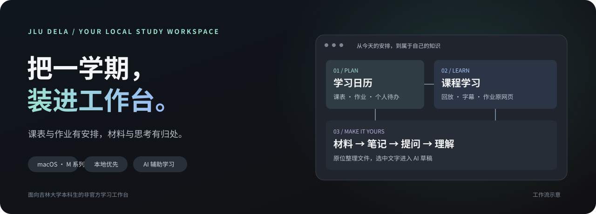
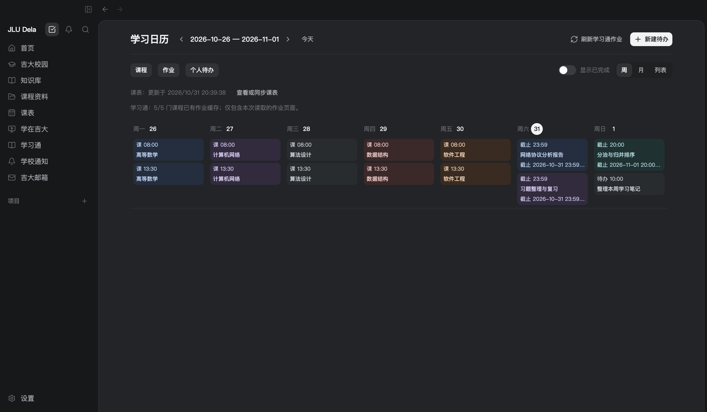
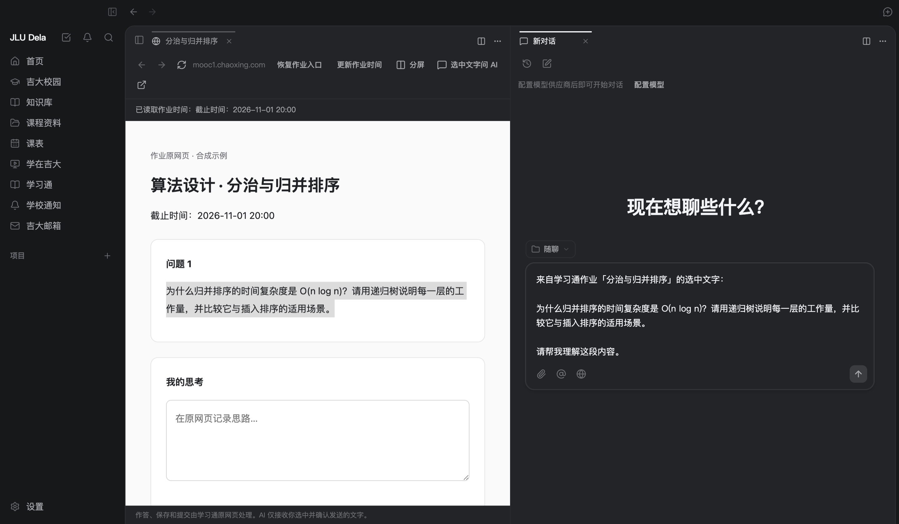
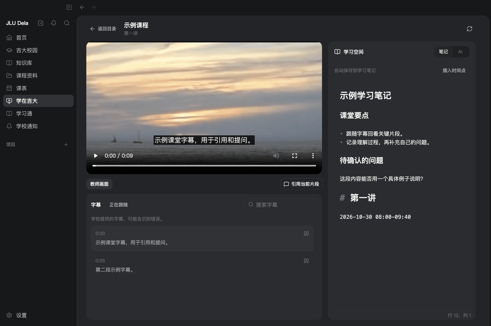
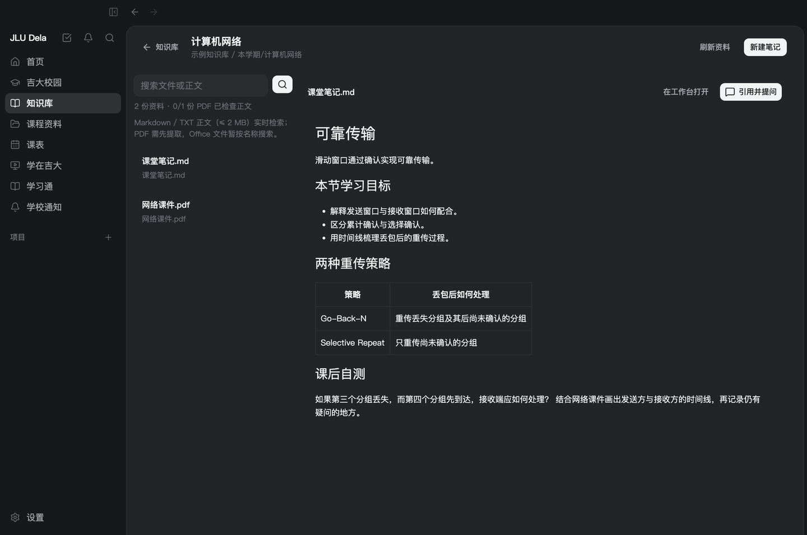
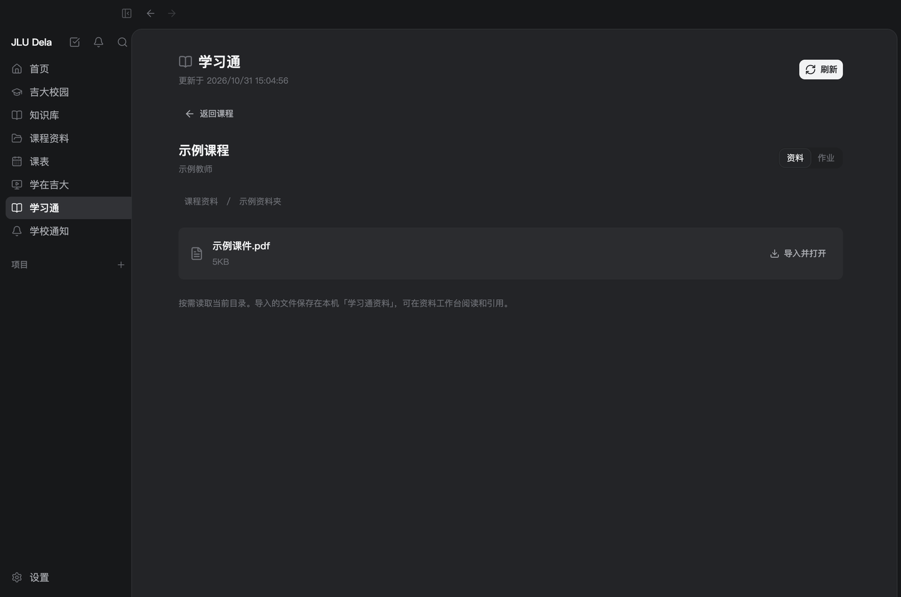
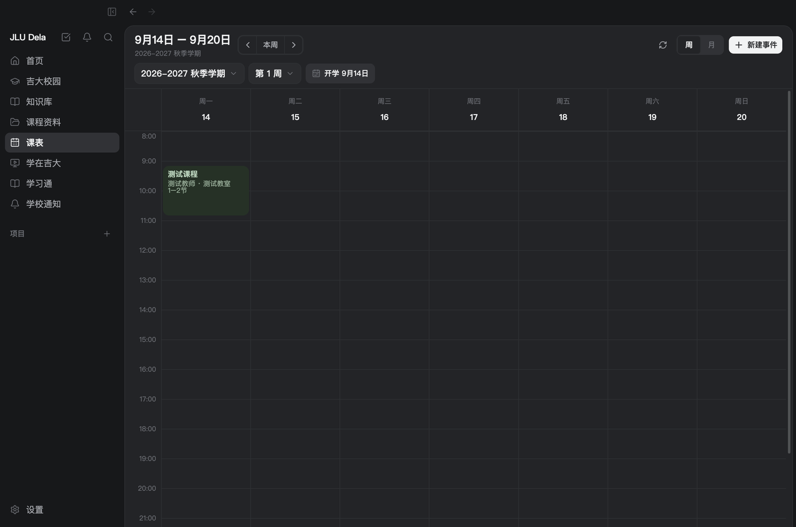
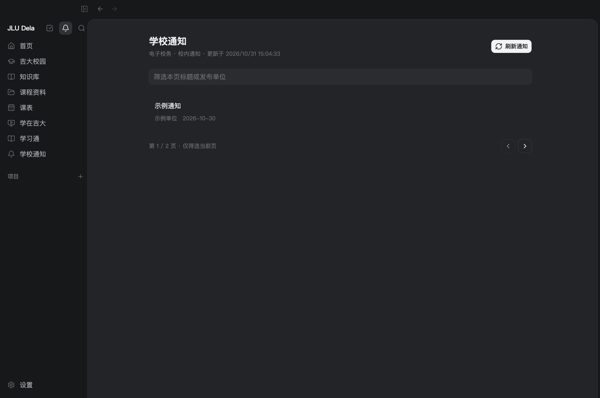
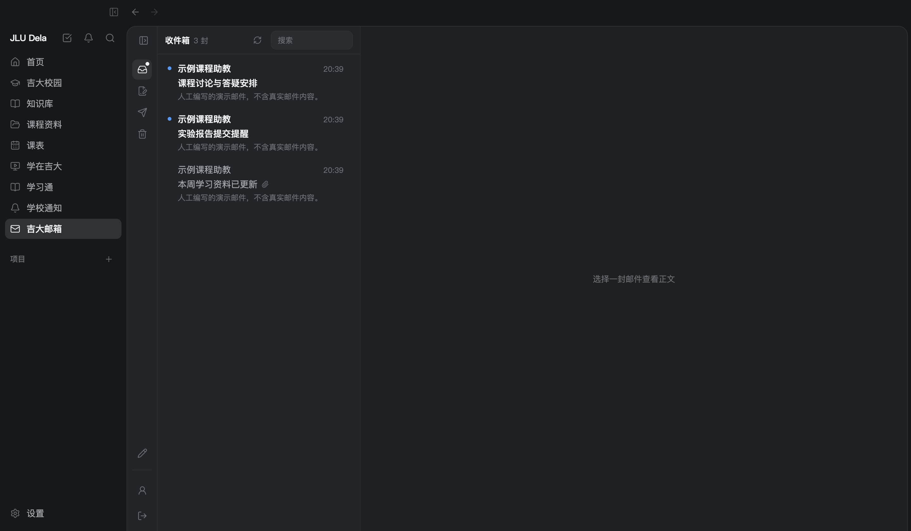

<p align="center">
  
</p>

<h1 align="center">JLU Dela</h1>
<p align="center"><strong>你的课表、作业、课堂与笔记，一个工作台。</strong></p>
<p align="center">面向吉林大学本科生 · 本地优先 · macOS Apple Silicon</p>

<p align="center">
  <a href="https://github.com/goya4140/JLU-Dela/releases/tag/v0.1.0-alpha.8"></a>
  <a href="https://github.com/goya4140/JLU-Dela/actions/workflows/ci.yml"></a>
  <a href="LICENSE"></a>
</p>

<p align="center">
  <a href="https://github.com/goya4140/JLU-Dela/releases/download/v0.1.0-alpha.8/JLU-Dela-0.1.0-alpha.8-mac-arm64.dmg"><strong>↓ 下载 macOS DMG</strong></a> ·
  <a href="https://github.com/goya4140/JLU-Dela/releases/tag/v0.1.0-alpha.8">Release / ZIP</a> ·
  <a href="docs/install-macos.md">安装说明</a> ·
  <a href="docs/user-guide.md">使用指南</a> ·
  <a href="https://github.com/goya4140/JLU-Dela/issues">反馈</a>
</p>



> **开发预览 · 非吉林大学官方产品。** 当前下载面向 macOS 13+、M 系列芯片，尚未做 Developer ID 签名和公证；Intel Mac 未验证。安装前请查看[说明](docs/install-macos.md)。

## 从「今天学什么」开始

课表、学习通作业和个人待办汇入同一份学习日历。按周安排、按月浏览，或切换列表逐项查看。明确的截止时间显示倒计时；只有相对时间的作业保留同步快照，避免把旧提示误当实时状态。



## 原网页在左，自己的思考在旁边

从作业卡片直达工作台内的学习通原网页，复用学习通登录。作答和提交交给平台，分屏留给笔记与对话；选中文字后提问，先形成草稿，再由你确认发送。



## 一边看课，一边整理

在应用内播放学在吉大回放，查找学校字幕、跳转到对应片段，边看边记。把字幕引用放进 AI 草稿，让问题保留课堂上下文。



## 从资料，到自己的知识库

已有文件夹可以直接连接，按课程阅读、搜索和创建 Markdown 笔记。材料留在原来的位置，笔记也写进自己的课程目录。



文件名及 Markdown / TXT 正文可直接检索；PDF 可手动提取文字、搜索并定位页码。目前尚无双链、语义检索、OCR 或 Office 正文索引。

## 校园信息，也在这里

| 学习通资料                                       | 课表                                                         |
| ------------------------------------------------ | ------------------------------------------------------------ |
|  |                   |
| 按需导入学校允许下载的文件，在工作台阅读与引用。 | 复用教务学期、教学周和节次，查看课程与调停课。               |
| **学校通知**                                     | **吉大邮箱**                                                 |
|           |                      |
| 阅读通知正文，查看附件入口；同步失败保留旧缓存。 | 本机收取、检索和阅读邮件，凭据加密保存；同步保留服务器草稿。 |

<details>
<summary>查看各平台的接入范围</summary>

| 来源                                                                   | 已提供的能力                                         |
| ---------------------------------------------------------------------- | ---------------------------------------------------- |
| [教务系统](https://iedu.jlu.edu.cn/jwapp/sys/emaphome/portal/index.do) | 本科课表、校历、节次与调停课                         |
| [电子校务](https://oa.jlu.edu.cn/defaultroot/login.jsp?access=oa)      | 通知列表、分页、正文与附件入口                       |
| [学在吉大](https://ilearntec.jlu.edu.cn/studycenter-web/index#/)       | 课程回放、多画面、学校字幕、笔记与播放进度           |
| [学习通](https://i.chaoxing.com/base)                                  | 课程与普通资料目录、文件导入、作业时间及工作台原网页 |
| [学生邮箱](https://mails.jlu.edu.cn/)                                  | 本机 IMAP/SMTP 收发与检索；教工邮箱使用自定义服务器  |

成绩、培养方案和选课尚未接入。学习通特殊「教师课件」暂未适配；作业提交由原网页处理。数据窗口和缓存时间会在功能页显示，不能据此认定已覆盖平台全部内容。

</details>

所有截图均来自应用界面。课程、邮件、作业、通知、文件和字幕是合成示例；作业网页与演示视频使用替代内容，不含真实账号、教学录像或私人邮件。

## 三步开始

1. **安装**：下载 [DMG](https://github.com/goya4140/JLU-Dela/releases/download/v0.1.0-alpha.8/JLU-Dela-0.1.0-alpha.8-mac-arm64.dmg)，拖入 Applications 并启动。
2. **连接**：按向导连接需要的平台。教务、电子校务与学在吉大尝试复用校园认证；学习通独立登录，邮箱单独配置。
3. **学习**：同步课表，连接课程资料文件夹，或打开回放。只使用校园与本地功能，可以跳过模型配置。

使用 AI 时再配置自己的模型服务。资料引用先进入草稿，发送后相关内容才会交给所选服务；费用与数据处理方式由该服务决定。校园连接失败会保留旧数据，不会把网络错误一律当作登录失效。

[安装与校验](docs/install-macos.md) · [使用须知与配置](docs/user-guide.md) · [更新日志](CHANGELOG.md) · [隐私说明](docs/privacy.md)

<details>
<summary>本地开发与验证</summary>

使用 [.node-version](.node-version) 和 [package.json](package.json) 指定的 Node.js / pnpm。

```sh
pnpm install --frozen-lockfile
pnpm dev
```

| 命令                        | 用途                                        |
| --------------------------- | ------------------------------------------- |
| `pnpm check`                | 格式、lint、类型检查、构建与单元测试        |
| `pnpm smoke`                | Electron 启动、SQLite、preload 隔离与运行时 |
| `pnpm smoke:timetable`      | 课表读取、认证恢复与缓存保留                |
| `pnpm smoke:platforms`      | 通知、回放、字幕、笔记与 AI 草稿            |
| `pnpm smoke:chaoxing`       | 课程、资料导入与原生作业网页                |
| `pnpm smoke:study-calendar` | 课表、作业与个人待办聚合                    |
| `pnpm smoke:knowledge`      | 原位资料、PDF 检索、引用与笔记              |
| `pnpm smoke:setup`          | 首次引导、邮箱配置与连接恢复                |
| `pnpm demo:capture`         | 在隔离环境中生成新版合成演示截图            |
| `pnpm package:mac`          | 构建 Apple Silicon DMG / ZIP                |

主分支与 PR 运行 macOS CI；发布 tag 触发安装包验证和 Release 发布，详见[开发文档](docs/DEVELOPMENT.md)。自动化使用合成数据，不访问真实校园账号。

`pnpm web` 提供共用本机学习数据的浏览器预览，仅监听本机；不是公网多用户服务，见[网页端说明](docs/web.md)。

</details>

<details>
<summary>本机数据与当前限制</summary>

- 应用状态、校园会话与加密邮箱凭据：`~/Library/Application Support/JLU-Dela/`。
- 默认资料：`~/Documents/JLU-Dela/`；原位知识库继续使用你选择的目录。
- Markdown / TXT 正文检索限 2 MB；PDF 文字提取限每份 40 MB、300 页，源文件变动后需重新提取。
- 校园网页接入不保存学校密码，邮箱凭据单独配置并加密保存在本机。会话有效期由学校决定，退出重开不保证永久免登录。
- AI 不等于离线推理；发送的问题、资料和工具结果可能进入所选模型服务。
- 当前为开发预览，不承诺全部账号、课程页面、网络环境或自动更新均已适配。

</details>

## 致谢与许可

JLU Dela 基于 [Dela](https://github.com/Chang-Yo/Dela) 的工作台持续开发吉林大学校园接入与学习功能，保留原项目历史和版权声明，遵循 [GPL-3.0-or-later](LICENSE)。当前使用原创折纸天鹅标识。感谢原作者、贡献者与参与测试的同学。

[贡献指南](CONTRIBUTING.md) · [使用条款](docs/terms.md) · [隐私说明](docs/privacy.md)
