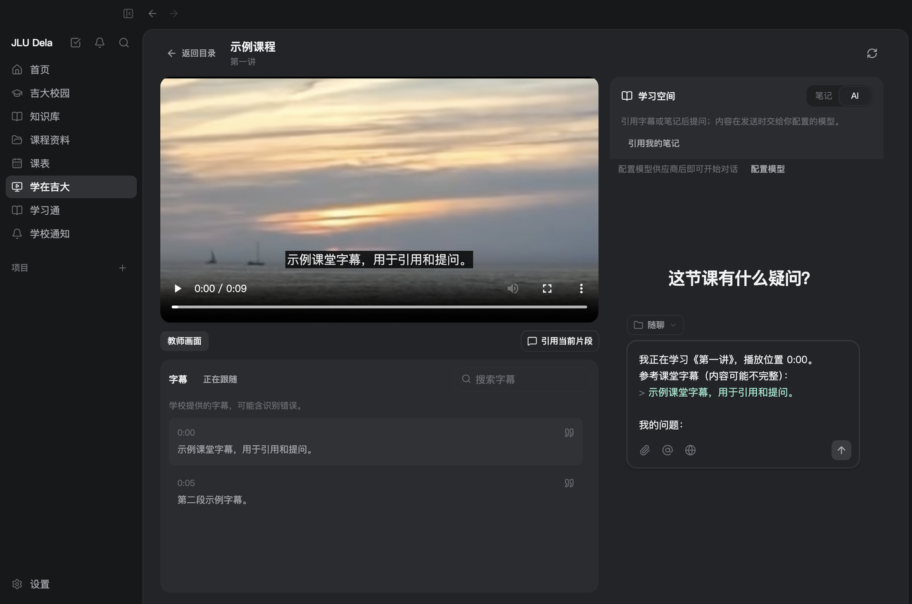
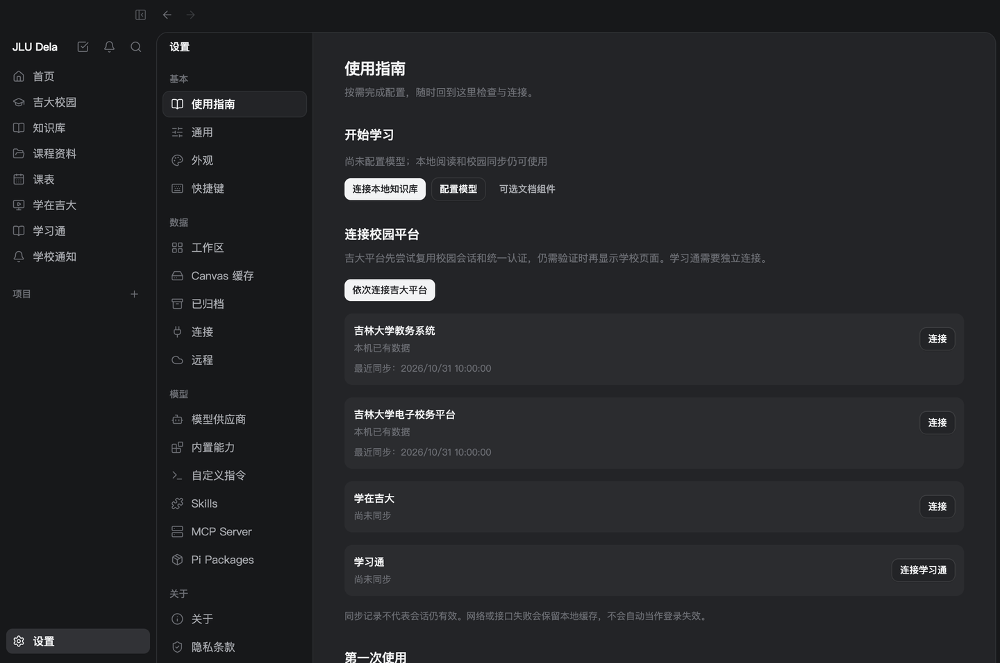

<p align="center">
  
</p>

<h1 align="center">JLU Dela</h1>

<p align="center">把课表、课程资料、课堂回放和笔记放在一起。</p>
<p align="center">面向吉林大学本科生的本地学习工作台 · macOS Apple Silicon 开发预览</p>

<p align="center">
  <a href="docs/user-guide.md">使用指南</a> ·
  <a href="#开始使用">开始使用</a> ·
  <a href="CHANGELOG.md">更新日志</a> ·
  <a href="https://github.com/goya4140/JLU-Dela/issues">反馈问题</a>
</p>

## 一边看课，一边整理

在应用内播放学在吉大回放，查找字幕、记录笔记，再把当前片段带进 AI 对话草稿。


> 展示的是应用真实界面，课程、通知、文件和字幕均为人工示例；视频为替代素材，不含真实账号或教学录像。AI 引用先进入草稿，点击发送才调用你配置的模型。

## 你的课程知识库

连接已有文件夹，按课程阅读和整理。搜索 Markdown / TXT 正文，手动提取 PDF 文字并定位页码；新笔记以 Markdown 保存在课程目录里。


连接时保留文件原位；编辑和新建笔记会实际写入文件。目前提供关键词检索，尚未提供双链、语义检索、OCR 或 Office 正文索引。

## 校园信息，集中查看

| 课表                                               | 学习通资料                                               |
| -------------------------------------------------- | -------------------------------------------------------- |
|     |    |
| 按学期和教学周查看课程，兼顾调停课与自建事件。     | 查看课程、资料目录和作业状态，按需导入允许下载的文件。   |
| **学校通知**                                       | **回放与 AI 草稿**                                       |
|   |  |
| 按页读取电子校务通知，缓存正文并打开学校附件入口。 | 搜索学校字幕、跳转播放位置，引用片段后补充问题。         |

| 来源                                                                   | 已提供的能力                                       |
| ---------------------------------------------------------------------- | -------------------------------------------------- |
| [教务系统](https://iedu.jlu.edu.cn/jwapp/sys/emaphome/portal/index.do) | 本科课表、校历、节次、调停课信息                   |
| [电子校务](https://oa.jlu.edu.cn/defaultroot/login.jsp?access=oa)      | 通知列表、分页、正文与附件入口                     |
| [学在吉大](https://ilearntec.jlu.edu.cn/studycenter-web/index#/)       | 学期、课程、回放、多画面、学校字幕、笔记与播放进度 |
| [学习通](https://i.chaoxing.com/base)                                  | 当前课程、普通资料目录、作业状态与文件导入         |
| [学生邮箱](https://mails.jlu.edu.cn/)                                  | 本机 IMAP/SMTP 收发与检索；教工邮箱改用第三方 IMAP |

校园接入均为预览版本，已在本人会话下验证主要流程；其他账号、长期过期和网站改版仍需持续验证。成绩、培养方案、选课和作业提交尚未接入。特殊「教师课件」入口暂不支持；列表及作业时间提示以本次同步范围和时间为准。

## 开始使用

**当前代码版本：`0.1.0-alpha.7`。非吉林大学官方产品。**

开发预览安装包可通过 [macOS development packages](https://github.com/goya4140/JLU-Dela/actions/workflows/release.yml) 工作流构建，在对应运行的 Artifacts 下载。预览包尚未配置 Developer ID 签名与公证；Intel Mac 尚未验证。

首次启动会依次引导你阅读使用须知、配置模型、连接校园平台和选择可选组件。模型与平台配置都可以跳过，未完成的向导会在下次启动继续。已在使用的用户可直接打开 **设置 → 使用指南**。



点击「依次连接吉大平台」，应用先尝试已有校园会话及统一认证，仍需验证时再显示学校页面；是否能免去重复登录由学校决定。学习通使用独立会话，需单独连接。网络或接口错误会保留旧缓存，不会一律当作登录失效。

本地阅读和校园同步不要求配置模型。使用 AI 时填写模型服务的 API Key，资料、对话及工具结果可能进入所选模型服务；API Key 与校园密码不同。详见 [使用指南与须知](docs/user-guide.md)。

<details>
<summary>本地开发与验证</summary>

使用 [`.node-version`](.node-version) 指定的 Node.js，以及 [`package.json`](package.json) 指定的 pnpm。

```sh
pnpm install --frozen-lockfile
pnpm dev
```

| 命令                        | 用途                                  |
| --------------------------- | ------------------------------------- |
| `pnpm check`                | 格式、lint、类型检查、构建与单元测试  |
| `pnpm smoke`                | Electron 基础冒烟                     |
| `pnpm smoke:timetable`      | 课表读取、认证恢复与失败保留缓存      |
| `pnpm smoke:platforms`      | 通知、视频、字幕、笔记与 AI 草稿      |
| `pnpm smoke:chaoxing`       | 独立会话、课程、目录、作业与资料导入  |
| `pnpm smoke:study-calendar` | 学习日历聚合、作业时间与读取范围      |
| `pnpm smoke:knowledge`      | 原位课程资料、PDF 检索、引用与笔记    |
| `pnpm smoke:setup`          | 首次引导、配置恢复与多平台顺序连接    |
| `pnpm smoke:web`            | 本机网页端与桌面学习数据共用          |
| `pnpm package:mac`          | 构建 Apple Silicon 开发预览 DMG / ZIP |

自动化检查使用人工数据，不访问真实校园账号。主分支推送运行 macOS CI，安装包工作流由维护者按需运行。

本机网页预览通过 `pnpm web` 启动，连接本机工作台，共用已接入的校园内容、笔记和 AI 会话；仅监听本机，不支持公网或多用户部署，详见 [网页端说明](docs/web.md)。

</details>

<details>
<summary>数据位置与当前范围</summary>

- 应用状态与会话：`~/Library/Application Support/JLU-Dela/`。
- 默认资料目录：`~/Documents/JLU-Dela/`，可在设置中更改。
- 原位知识库：继续使用你连接的目录。
- 技能目录：`~/.jlu-dela/skills/`。

Markdown / TXT 正文检索限 2 MB 以内文件；PDF 文字在本机手动提取，每份限 40 MB、300 页，源文件变动后需重新提取。校园会话可在退出重开后尝试复用，有效期仍由平台决定；校园网页接入不保存学校密码；邮箱凭据需单独配置并加密保存在本机。

内部 `window.dela` API、`dela` 命令和部分存量模块继续沿用。未适配的校园模块不表示已支持吉大。架构与接入范围见 [开发文档](docs/DEVELOPMENT.md) 和 [吉大接入计划](docs/jlu-integration.md)。

</details>

## 致谢与许可

JLU Dela 在 [Dela](https://github.com/Chang-Yo/Dela) 的工作台基础上，持续开发吉林大学校园接入与课程学习功能。保留原项目历史和版权声明，遵循 [GPL-3.0-or-later](LICENSE)；当前应用采用原创折纸天鹅标识。感谢原作者与贡献者。

[贡献指南](CONTRIBUTING.md) · [使用条款](docs/terms.md) · [隐私说明](docs/privacy.md)
